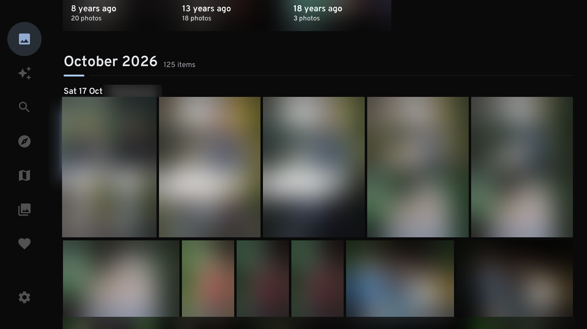
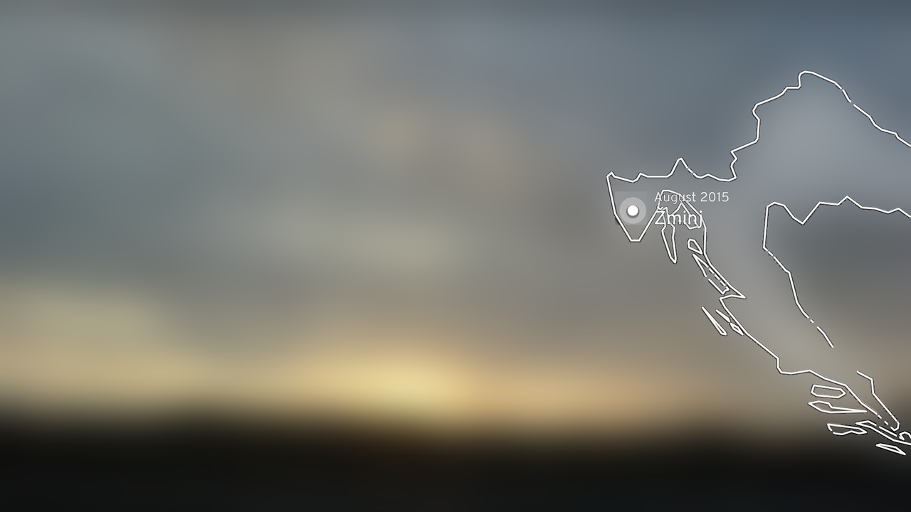
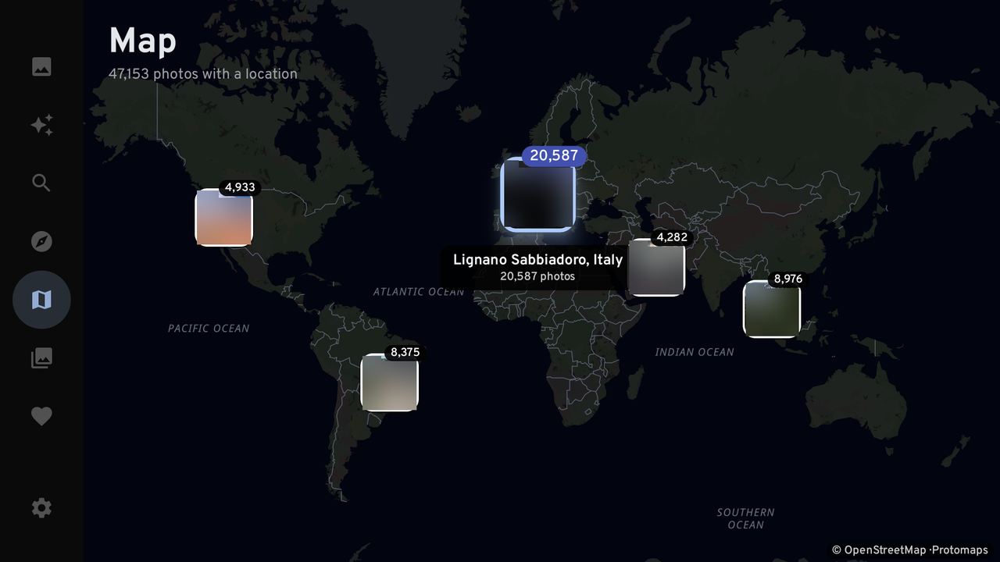
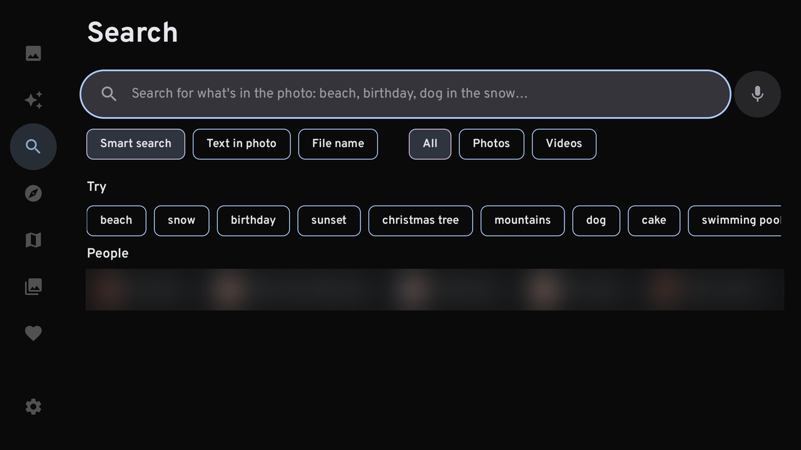
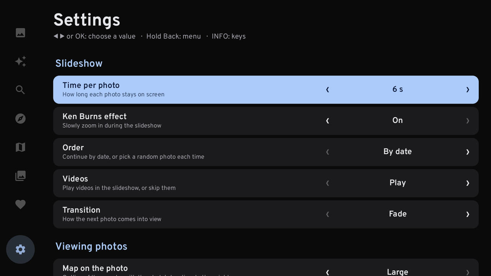
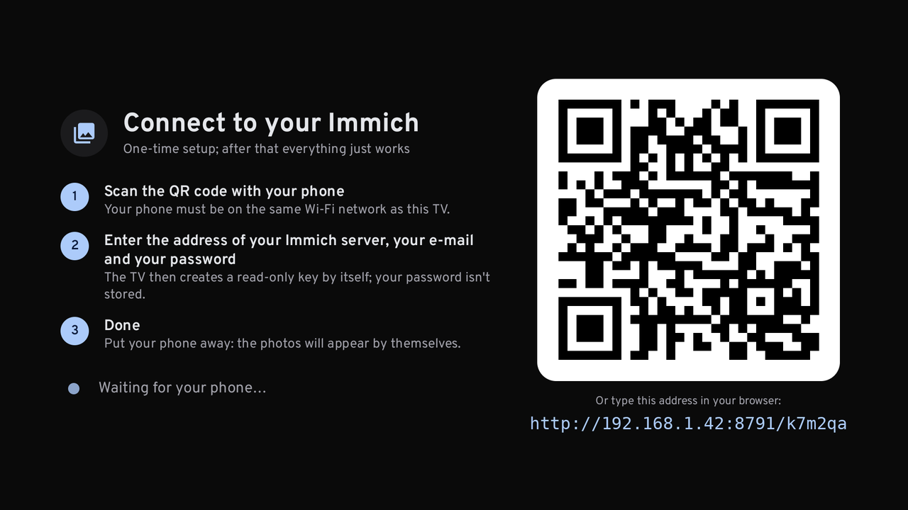
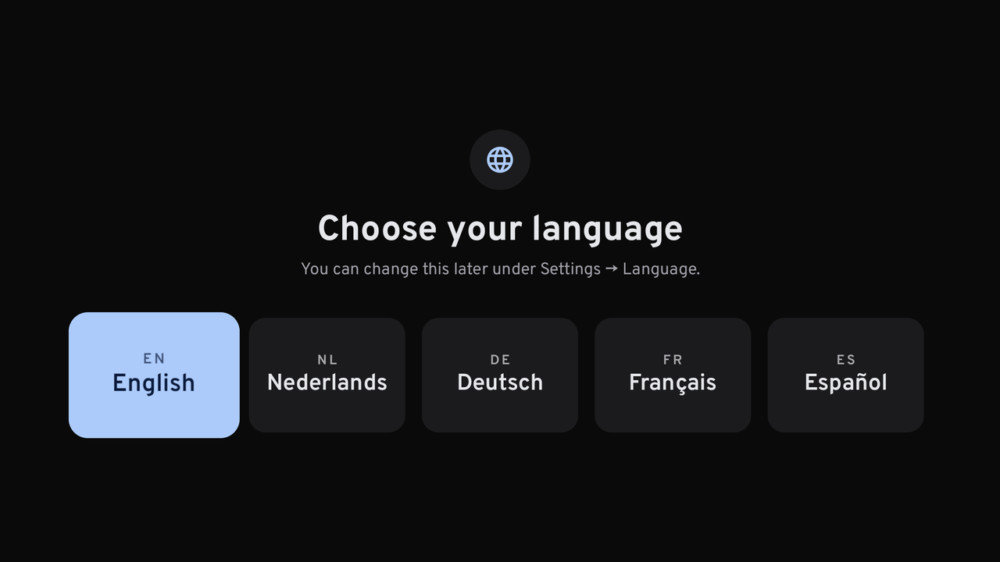

# TV Client for Immich (unofficial)

[](https://github.com/neforce/android-tv-immich-client/releases)
[](https://github.com/neforce/android-tv-immich-client/releases/latest)
[](LICENSE)

A fast, remote-friendly client for [Immich](https://immich.app) for Android TV boxes (NVIDIA Shield, Chromecast with Google TV, and other Android TV 8+ devices). Browse your whole photo library on the big screen, relive memories, search with Immich's smart search and explore your photos on a world map, all with the remote control.

> **Unofficial app.** This is an independent, community-made client. It is **not** made, endorsed or supported by the Immich project or its maintainers, and it is not the official Immich app. Please don't report problems with this app to the Immich team. "Immich" is a trademark of its respective owners and is only used here to describe compatibility.



## Features

- **Timeline**: your entire library grouped by month and day, in a justified grid like Immich itself. Thumbnails start as blurred [ThumbHash](https://evanw.github.io/thumbhash/) previews and load month by month while you scroll, so even libraries with 100,000+ items stay smooth.
- **Memories**: "On this day" cards at the top of the timeline and a dedicated Memories screen for the past week, played as a slideshow.
- **Viewer**: full-screen photos and videos, a blurred backdrop instead of black bars, an info panel (date, people, place, camera and lens), and an animated country map with the location of the photo.
- **Slideshow**: adjustable interval, optional Ken Burns zoom, chronological or shuffled, fade or slide transitions.
- **Search**: Immich smart search ("beach", "birthday cake", "dog in the snow"), text in photos (OCR) and file names, with a built-in on-screen keyboard and voice search.
- **Explore**: people (faces) and places.
- **Albums**: sort by recent activity, newest photos, name or size, filter shared albums, search by name.
- **World map**: all geotagged photos as clusters on a smooth vector map (dark, light or satellite) that split up as you zoom in.
- **Favorites**.
- **Settings**: slideshow, viewer, timeline, map, accent colour, app name and icon, greeting, start screen and more. See [Settings](#settings).
- **Languages**: English, Dutch, German, French and Spanish, with a language picker on first start.
- **Easy pairing**: scan a QR code with your phone and log in. No typing of long API keys with the remote.

| | |
|---|---|
|  |  |
|  |  |
|  |  |

## Requirements

- An Android TV device running Android 8.0 (API 26) or newer, ARM 32- or 64-bit.
- An Immich server, version 2.x or 3.x (developed against 3.3), reachable from the TV box. Self-signed HTTPS certificates are not supported; use plain HTTP on your local network or a valid certificate.

## Installation

1. Download the APK from the [latest release](https://github.com/neforce/android-tv-immich-client/releases/latest), or build it yourself (see [Building](#building)).
2. Copy it to your TV box, for example with the **Downloader** app (Play Store) or a USB stick and a file manager, and install it. You may need to allow installing apps from unknown sources for that app.
3. Open the app, choose your language and pair it with your Immich server (see below).

## Pairing with Immich

On first start the app shows a QR code:

1. Scan the QR code with a phone on the same network as the TV box. A small web page that the app serves itself opens on your phone.
2. Enter the address of your Immich server (as you would type it in a browser, e.g. `192.168.1.10:2283` or `https://photos.example.com`), your e-mail address and your password, and tap **Connect**.
3. The app logs in, creates its own **read-only API key** named "Photos on &lt;device name&gt;", logs out again and starts. Your password is never stored.

Alternatively, expand "Or paste an existing API key" on the same page. The key needs exactly these permissions:

`asset.read`, `asset.view`, `album.read`, `memory.read`, `person.read`, `map.read`, `user.read`

The app checks each permission and tells you which ones are missing. You can connect again or disconnect the device later under **Settings → Account**. To revoke access, delete the key in Immich under *Account settings → API keys*.

The pairing page is only served while the pairing screen is open, only on the local network, and only with a one-time code from the QR code.

<details>
<summary>Setting the key with adb (for developers)</summary>

```sh
adb shell am broadcast -a com.immichclient.tv.SET_KEY -n com.immichclient.tv/.SleutelOntvanger \
  --es sleutel <API key> --es server http://192.168.1.10:2283 [--es taal en]
```

The receiver requires the `DUMP` permission, so only the adb shell can send it, not other apps.
</details>

## Remote control

| Where | Key | Action |
|---|---|---|
| Everywhere | **Back (long press)** | Open the menu |
| Everywhere | **Menu** (if your remote sends it) | Open the menu |
| Everywhere (not in the viewer) | **Info** | Show all shortcuts |
| Timeline | **⏩ / ⏪** | Next / previous month |
| Timeline, albums, search | **Play/Pause** | Start a slideshow from the selected photo |
| Viewer | **◀ ▶** | Previous / next photo |
| Viewer | **OK** | Start / stop the slideshow (videos: pause) |
| Viewer | **▲ ▼** | Info panel |
| Viewer | **⏩ / ⏪** | 10 photos forward / back (videos: seek 10 s) |
| World map | **◀ ▶ ▲ ▼** | Select the next cluster in that direction, or pan |
| World map | **OK** | Zoom in on the cluster; open the photos at the deepest level |
| World map | **⏩ / ⏪** | Zoom in / out |
| World map | **Back** | Back to the whole world; press again to leave the map |

## Settings

| Group | Setting | Options |
|---|---|---|
| Slideshow | Time per photo | 3 – 20 s (default 6 s) |
| | Ken Burns effect | on / off |
| | Order | by date / shuffled |
| | Videos | play / skip |
| | Transition | fade / slide |
| Viewer | Country map on the photo | off / small / large |
| | Date and place bar | hide after 2 – 10 s / always show |
| | Counter | on / off |
| Timeline | Photo size | small / normal / large |
| | Default order | newest / oldest first |
| | Partner's photos | on / off |
| | Memories at the top | on / off |
| | Start screen | Photos / Memories / Map / Albums / Favorites |
| | Greeting | off / automatic ("Good evening, Anna") / custom text |
| Map | Start view | whole world / Europe / country with the most photos / last viewed place |
| | Clustering | fine / normal / coarse |
| | Map style | dark / light / satellite |
| Appearance | Language | English, Nederlands, Deutsch, Français, Español |
| | Accent colour | blue / green / orange / pink / purple / grey |
| | App name and icon | four variants for the launcher |
| Storage | Clear image cache | |
| Account | Server, signed in as, connect again, disconnect | |

## Building

Requirements: JDK 17 and the Android SDK (platform 35).

```sh
./gradlew :fotos:assembleRelease
# → fotos/build/outputs/apk/release/fotos-release.apk
```

Always use the release build on a TV: Jetpack Compose is noticeably slower in debug builds. For the smoothest first start, precompile the app once:

```sh
adb install -r fotos/build/outputs/apk/release/fotos-release.apk
adb shell cmd package compile -m speed -f com.immichclient.tv
```

**Signing.** Without configuration the release build is signed with the debug key. To use your own key (needed if you want to install updates over an existing installation), create `~/.android/immichclient-release.properties`:

```properties
storeFile=/path/to/your-release.jks
storePassword=...
keyAlias=...
keyPassword=...
```

or set the environment variables `IMMICHCLIENT_KEYSTORE`, `IMMICHCLIENT_KEYSTORE_PASSWORD`, `IMMICHCLIENT_KEY_ALIAS` and `IMMICHCLIENT_KEY_PASSWORD`. Never commit the keystore or this file.

### Notes for developers

- Kotlin, Jetpack Compose for TV (`androidx.tv:tv-material`), [Coil 3](https://coil-kt.github.io/coil/), [Media3/ExoPlayer](https://developer.android.com/media/media3) and [MapLibre Native](https://maplibre.org/).
- Source code identifiers and comments are in Dutch. User-facing strings live in `res/values*/strings.xml`. To add a language, add a `values-xx/strings.xml`, add the code to `resourceConfigurations` in `fotos/build.gradle.kts` and to the list in `Taal.kt`, and generate localized banners with `fotos/banners.py`.
- The app is tuned for 2 GB TV boxes: a fixed, small image cache, previews decoded at screen size, small video buffers and a lazily loaded timeline. Keep memory usage in mind when adding features.
- `fotos/landen_bin.py` builds `assets/landen.bin` (country outlines for the map in the viewer) from Natural Earth data.

## Credits and licences

- [Immich](https://immich.app) (unofficial client, not affiliated). This app uses its public API and the map styles the Immich server provides (vector tiles © [OpenStreetMap](https://www.openstreetmap.org/copyright) contributors, [Protomaps](https://protomaps.com)).
- Satellite imagery: [Sentinel-2 cloudless](https://s2maps.eu) by [EOX IT Services GmbH](https://eox.at) (contains modified Copernicus Sentinel data), licensed CC BY-NC-SA 4.0, **non-commercial use only**.
- Country outlines: [Natural Earth](https://www.naturalearthdata.com) (public domain).
- [ThumbHash](https://github.com/evanw/thumbhash) by Evan Wallace (MIT), ported to Kotlin.
- [Overpass](https://github.com/RedHatOfficial/Overpass) font (SIL Open Font License 1.1, see `fotos/OFL-Overpass.txt`).
- This project: MIT licence (see `LICENSE`).
- [MapLibre Native](https://github.com/maplibre/maplibre-native) (BSD 2-Clause), [Coil](https://github.com/coil-kt/coil) (Apache 2.0), [ZXing](https://github.com/zxing/zxing) (Apache 2.0), AndroidX (Apache 2.0), OkHttp (Apache 2.0).
